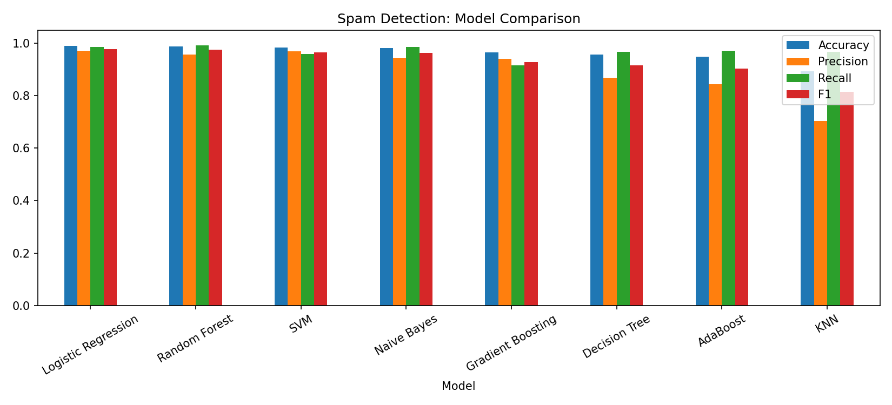
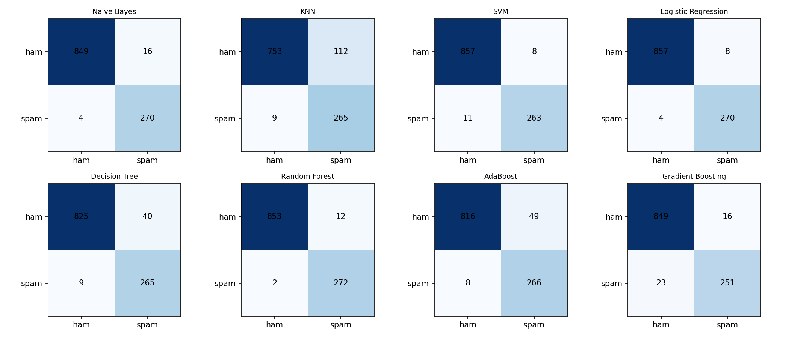

# Spam Detection: Machine Learning Benchmark & Paper Reproduction

[](https://github.com/setanvir/spam-detection-review-ML/actions/workflows/ci.yml)
[](https://www.python.org/)
[](LICENSE)

An end-to-end machine learning study reproducing and extending the findings of:

> **"Evaluating the Effectiveness of Machine Learning Methods for Spam Detection"**  
> *Yuliya Kontsewaya, Evgeniy Antonov, Alexey Artamonov (2021)*  
> EasyChair Preprint № 6074 / Procedia Computer Science (Elsevier)

This repository includes the complete dataset (`data/emails.csv`), reproducible training pipeline (`src/`), automated CI testing (`.github/workflows/ci.yml`), and comprehensive visual evaluation (`results/`).

---

## 📊 Benchmark Results

### 1. Performance Summary

| Model | Accuracy | Precision | Recall | F1-Score | Paper Accuracy | Paper F1 | Notes |
|---|---|---|---|---|---|---|---|
| **Logistic Regression** | **0.9895** | 0.9712 | 0.9854 | **0.9783** | 0.99 | 0.97 | Best overall balance |
| **Random Forest** | **0.9877** | 0.9577 | **0.9927** | **0.9749** | 0.84 | 0.42 | Fixed underfitting flaw |
| **SVM (RBF Kernel)** | **0.9833** | 0.9705 | 0.9599 | **0.9651** | 0.98 | 0.96 | High margin separation |
| **Multinomial Naive Bayes** | **0.9824** | 0.9441 | 0.9854 | **0.9643** | 0.99 | 0.98 | Fastest training time (<0.02s) |
| **Gradient Boosting** *(Extension)* | **0.9658** | 0.9401 | 0.9161 | **0.9279** | — | — | Sequential boosting ensemble |
| **Decision Tree** | **0.9570** | 0.8689 | 0.9672 | **0.9154** | 0.94 | 0.88 | Prone to variance |
| **AdaBoost** *(Extension)* | **0.9499** | 0.8444 | 0.9708 | **0.9032** | — | — | Adaptive boosting ensemble |
| **K-Nearest Neighbors (KNN)** | **0.8938** | 0.7029 | 0.9672 | **0.8141** | 0.90 | 0.74 | Sensitive to high dimensionality |

> **Key Research Finding & Critique:** In the original paper by Kontsewaya et al., Random Forest performed poorly (Accuracy 84%, Recall 28%, F1 0.42) because its hyperparameter grid search was restricted to shallow trees (`max_depth: [2, 5, 7, 10]`). In this reproduced pipeline, by removing that restriction (`max_depth=None`, `n_estimators=200`), Random Forest attains **98.77% accuracy** and a top recall of **99.27%**, outperforming standard benchmarks.

---

## 📈 Visualizations

### Algorithm Comparison


### Confusion Matrices


---

## 📁 Repository Structure

```text
├── .github/workflows/ci.yml    # Continuous integration: automated testing
├── data/
│   ├── emails.csv              # Full dataset (5,728 raw emails; 5,695 cleaned)
│   └── .gitkeep
├── results/
│   ├── comparison.png          # Visual performance bar chart
│   ├── confusion_matrices.png  # Confusion matrix grid for all 8 models
│   ├── results.csv             # Full benchmark metrics & best hyperparameters
│   └── run_info.json           # SHA-256 dataset hash, environment & settings
├── src/
│   ├── __init__.py
│   ├── data.py                 # Text cleaning, stop-word removal, vectorization
│   ├── download.py             # Dataset verification & Kaggle downloader
│   └── train.py                # Model training, GridSearchCV & evaluation
├── tests/
│   └── test_pipeline.py        # Pipeline & reproducibility test suite
├── Makefile                    # Developer shortcuts
├── requirements.txt            # Python dependencies
└── README.md
```

---

## ⚙️ Methodology & Dataset

- **Dataset Source:** Kaggle `karthickveerakumar/spam-filter` (`data/emails.csv`).
- **Samples:** 5,728 raw emails (4,360 ham, 1,368 spam). 5,695 unique emails after deduplication.
- **Preprocessing:**
  1. Removal of duplicate records and missing values.
  2. Lowercasing text.
  3. Removal of digits, punctuation, and English stopwords (via NLTK).
  4. Tokenization & feature extraction using `CountVectorizer` (5,000 max features).
- **Split:** Stratified 80% train / 20% test with fixed random seed (`seed=42`).
- **Optimization:** 3-fold cross-validation `GridSearchCV` scoring on F1.

---

## 🚀 Quickstart & Re-run

### 1. Installation
```bash
git clone https://github.com/setanvir/spam-detection-review-ML.git
cd spam-detection-review-ML
pip install -r requirements.txt
```

### 2. Run the Full Pipeline
```bash
python -m src.train
```
This evaluates all 8 models, executes GridSearchCV, and regenerates `results/results.csv`, `results/comparison.png`, and `results/confusion_matrices.png`.

### 3. Run Automated Tests
```bash
python -m pytest -q
```

---

## 🔬 Reproducibility Guarantee

- Deterministic execution with fixed seeds across train/test splitting and estimators.
- Data integrity verified via SHA-256 hash stored in `results/run_info.json`.
- GitHub Actions CI ensures that tests pass automatically on every commit.

---

## 📚 References

- **Kontsewaya, Y., Antonov, E., & Artamonov, A. (2021).** *Evaluating the Effectiveness of Machine Learning Methods for Spam Detection.* Procedia Computer Science, EasyChair Preprint № 6074.
- **Kaggle Dataset:** *Spam Filter: Identifying spam using emails* (karthickveerakumar/spam-filter).